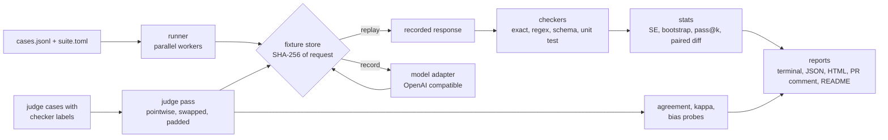

# calibra-eval

[](https://github.com/shreyas-tech7/calibra-eval/actions/workflows/ci.yml)

**Status:** v0.1.0-rc1. Every test passes offline. All results below come from deterministic fake models, because no free model provider was reachable from the build machine. The real-judge run is a [human step](docs/HUMAN_STEPS.md).

## The problem

Many teams grade their agents with an LLM judge and then trust the judge without checking it. A judge can be wrong in quiet ways. It can prefer the first answer it sees. It can reward a long answer over a short correct one. A pass rate of 0.8 on 40 questions also hides a wide margin of error.

calibra-eval is a small Python library and command line tool. It runs evals offline from recorded fixtures. Then it grades its own judge on answers whose correctness a checker already knows. It reports percent agreement, Cohen's kappa, a position bias probe and a verbosity bias probe, each with a bootstrap interval. It compares two models with paired statistics, so the interval reflects the questions they share.

## How it works



## Results

These tables are written by `calibra readme` from the files in `results/`. Nobody types the numbers. A test fails if they drift. Intervals are 95% percentile bootstrap intervals over questions, 2000 resamples, unless a row says otherwise. Every model named `fake:...` is a deterministic simulator, not a language model, so its numbers are simulated. They show that the pipeline works. They say nothing about any real model.

<!-- calibra:results:start -->
**code_tasks**: 16 cases, 5 samples each, seed 1, recorded 2026-11-20, replay mode. Source: `results/code_tasks.json`.

| Target | Model | Pass rate (95% CI) | pass@1 (95% CI) | pass@5 (95% CI) |
| --- | --- | --- | --- | --- |
| strong | fake:coder-strong (fake) | 0.900 [0.800, 0.975] | 0.900 [0.800, 0.975] | 1.000 [1.000, 1.000] |
| weak | fake:coder-weak (fake) | 0.575 [0.412, 0.725] | 0.575 [0.412, 0.725] | 0.875 [0.688, 1.000] |

Paired difference, strong minus weak (per-question pass rate): +0.325, paired 95% normal CI [0.202, 0.448], unpaired 95% normal CI [0.143, 0.507], paired bootstrap CI [0.212, 0.463].

**json_extract**: 20 cases, 3 samples each, seed 1, recorded 2026-11-20, replay mode. Source: `results/json_extract.json`.

| Target | Model | Pass rate (95% CI) | pass@1 (95% CI) | pass@3 (95% CI) |
| --- | --- | --- | --- | --- |
| extractor | fake:extractor (fake) | 0.883 [0.800, 0.967] | 0.883 [0.800, 0.967] | 1.000 [1.000, 1.000] |

**judge_calibration**: judge `fake:judge-sim` (fake), seed 1, recorded 2026-11-20, replay mode. Source: `results/judge_calibration.json`.

| Measure | Value (95% CI) |
| --- | --- |
| Cases with ground truth | 72 |
| Percent agreement | 0.764 [0.667, 0.848] |
| Cohen's kappa | 0.528 [0.337, 0.698] |
| Judge errors | 17 of 72 |
| Position: same pick after swap | 0.500 [0.333, 0.667] |
| Position: picks answer A | 0.667 [0.556, 0.778] |
| Position: accuracy gap, right answer first minus second | +0.333 [0.127, 0.540] (normal CI) |
| Verbosity: accepts wrong answers, raw | 0.333 [0.194, 0.500] |
| Verbosity: accepts wrong answers, padded | 0.639 [0.472, 0.778] |
| Verbosity: padded minus raw, wrong answers | +0.306 [0.134, 0.477] (normal CI) |
<!-- calibra:results:end -->

### Where the judge was wrong

The simulated judge reads the last number in a math answer, and it runs only the visible example tests of a code task. Those two habits cause most of its errors. The rest come from designed noise. Here are the first cases where it disagreed with the checker:

<!-- calibra:judge-errors:start -->
| Case | Task | Ground truth | Judge said |
| --- | --- | --- | --- |
| math-00-right | math | correct | wrong |
| math-03-wrong | math | wrong | correct |
| math-06-right | math | correct | wrong |
| math-09-wrong | math | wrong | correct |
| math-11-wrong | math | wrong | correct |
| math-12-right | math | correct | wrong |
| math-14-right | math | correct | wrong |
| math-15-wrong | math | wrong | correct |
| math-17-wrong | math | wrong | correct |
| math-18-right | math | correct | wrong |
| math-19-wrong | math | wrong | correct |
| code-add-wrong | code | wrong | correct |
<!-- calibra:judge-errors:end -->

### Seed 2 rerun

The pass@5 values of 1.000 look too good, so every suite was rerun with seed 2. The seed changes every model request, so seed 2 uses its own fixtures. The fake judge ignores the request seed, so its verdicts match seed 1 and only its bootstrap intervals move.

<!-- calibra:seed2:start -->
**code_tasks**: 16 cases, 5 samples each, seed 2, recorded 2026-11-20, replay mode. Source: `results/seed2/code_tasks.json`.

| Target | Model | Pass rate (95% CI) | pass@1 (95% CI) | pass@5 (95% CI) |
| --- | --- | --- | --- | --- |
| strong | fake:coder-strong (fake) | 0.812 [0.688, 0.925] | 0.812 [0.688, 0.925] | 1.000 [1.000, 1.000] |
| weak | fake:coder-weak (fake) | 0.550 [0.412, 0.688] | 0.550 [0.412, 0.688] | 0.938 [0.812, 1.000] |

Paired difference, strong minus weak (per-question pass rate): +0.263, paired 95% normal CI [0.151, 0.374], unpaired 95% normal CI [0.073, 0.452], paired bootstrap CI [0.150, 0.375].

**json_extract**: 20 cases, 3 samples each, seed 2, recorded 2026-11-20, replay mode. Source: `results/seed2/json_extract.json`.

| Target | Model | Pass rate (95% CI) | pass@1 (95% CI) | pass@3 (95% CI) |
| --- | --- | --- | --- | --- |
| extractor | fake:extractor (fake) | 0.733 [0.583, 0.867] | 0.733 [0.583, 0.867] | 0.950 [0.850, 1.000] |

**judge_calibration**: judge `fake:judge-sim` (fake), seed 2, recorded 2026-11-20, replay mode. Source: `results/seed2/judge_calibration.json`.

| Measure | Value (95% CI) |
| --- | --- |
| Cases with ground truth | 72 |
| Percent agreement | 0.764 [0.667, 0.861] |
| Cohen's kappa | 0.528 [0.335, 0.720] |
| Judge errors | 17 of 72 |
| Position: same pick after swap | 0.500 [0.333, 0.667] |
| Position: picks answer A | 0.667 [0.556, 0.778] |
| Position: accuracy gap, right answer first minus second | +0.333 [0.127, 0.540] (normal CI) |
| Verbosity: accepts wrong answers, raw | 0.333 [0.194, 0.500] |
| Verbosity: accepts wrong answers, padded | 0.639 [0.472, 0.806] |
| Verbosity: padded minus raw, wrong answers | +0.306 [0.134, 0.477] (normal CI) |
<!-- calibra:seed2:end -->

An interval of [1.000, 1.000] means every resample gave 1.0. It does not mean the true value is 1. With 16 questions, the honest reading is "no failure seen at k = 5 in this sample".

## Cost per task

Token counts for fake models are word counts, not real tokens. No price table is set, so no dollar cost is shown. Pass `--prices prices.toml` to add one.

<!-- calibra:cost:start -->
| Suite | Model | Calls | Tokens per task | Exact tokens | Latency p50 ms | Cost per task (USD) |
| --- | --- | --- | --- | --- | --- | --- |
| code_tasks | fake:coder-strong | 80 | 55.9 | no (word count) | 0.029 | no price set |
| code_tasks | fake:coder-weak | 80 | 54.5 | no (word count) | 0.025 | no price set |
| json_extract | fake:extractor | 60 | 47.4 | no (word count) | 0.009 | no price set |
| judge_calibration | fake:judge-sim | 216 | 249.8 | no (word count) | 0.029 | no price set |
<!-- calibra:cost:end -->

## Run it in 10 minutes

You need Python 3.11 or newer and git. No key and no network are needed for replay.

```bash
git clone https://github.com/shreyas-tech7/calibra-eval.git
cd calibra-eval
./init.sh                                   # venv, install, lint, all tests offline
.venv/bin/calibra run examples/*/suite.toml # replay the three suites into results/
.venv/bin/calibra report --html docs/index.html
bash scripts/replay_twice.sh                # proves byte-identical JSON across replays
```

Open `docs/index.html` in a browser for the results page. `docs/DEMO.md` shows a real terminal session.

To use a real model, set an OpenAI-compatible endpoint and record:

```bash
export LLM_BASE_URL=https://api.groq.com/openai/v1   # or any OpenAI-compatible URL
export LLM_API_KEY=...                               # read from the environment only
.venv/bin/calibra run --record examples/judge_calibration/suite.real.toml
```

Write your own suite: one JSON object per line in `cases.jsonl` with `id`, `input`, `checker` and an optional `ground_truth`, plus a `suite.toml` that names the target. See `examples/` for all three kinds.

## Limits

- No real model has been run yet. Every number above comes from simulators.
- The fake judge's error rate is partly designed. Its kappa shows the method works, not how good any judge is.
- 72 judge cases give wide intervals. A kappa interval about 0.4 wide is normal at this size.
- Token counts for fake models are word counts.
- Self-enhancement bias (a judge that favors its own model's answers) needs two real model families, so it is not probed yet.
- Code checkers run candidate code in a subprocess with a timeout. That is not a security sandbox. Only run code you trust.

## Glossary

- **Case:** one task with an input, a checker and optional ground truth.
- **Checker:** code that decides pass or fail. No opinion involved.
- **Fixture:** a saved model response, stored under the SHA-256 hash of the canonical request JSON.
- **Replay:** answering every model call from fixtures. It costs nothing and always gives the same bytes.
- **Judge:** a model that grades answers. calibra-eval grades the judge.
- **Percent agreement:** how often the judge matches the checker.
- **Cohen's kappa:** agreement corrected for chance. 0 means no better than guessing from the base rates, 1 means perfect.
- **pass@k:** the chance that at least one of k samples passes, from the unbiased formula 1 - C(n-c, k) / C(n, k).
- **Paired difference:** the per-question difference between two models, averaged. Its interval is tighter when the models find the same questions hard.
- **Bootstrap interval:** resample the questions with replacement many times and take the middle 95% of the results.

## Related work

calibra-eval does not try to match these on breadth. Its focus is judge calibration and paired statistics, with numpy as the only runtime dependency and full offline replay.

- [Inspect AI](https://github.com/UKGovernmentBEIS/inspect_ai): MIT licensed eval framework with over 200 pre-built evals.
- [promptfoo](https://github.com/promptfoo/promptfoo): test and red-team prompts, agents and RAG pipelines.
- [DeepEval](https://github.com/confident-ai/deepeval): pytest-style LLM evaluation with many metrics.
- [Ragas](https://github.com/explodinggradients/ragas): evaluation for retrieval-augmented generation.
- [Judging LLM-as-a-Judge with MT-Bench and Chatbot Arena](https://arxiv.org/abs/2306.05685): names position, verbosity and self-enhancement bias.
- [Adding Error Bars to Evals](https://arxiv.org/abs/2411.00640) by Evan Miller: the statistics this tool follows.

## How this was built

AI agents wrote most of the code under Shreyas's direction. The full build prompt is in [docs/build/BUILD_PROMPT.md](docs/build/BUILD_PROMPT.md). Choices are logged in [DECISIONS.md](DECISIONS.md) and problems in [BLOCKERS.md](BLOCKERS.md).

Human checks, not done yet:

- Shreyas has not yet read the diff.
- Shreyas has not yet checked the hand-computed reference values in `tests/reference/`.
- No real-model run has been checked by a human.

MIT licensed. See [LICENSE](LICENSE).
